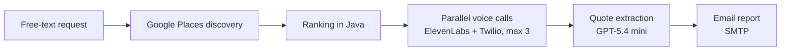
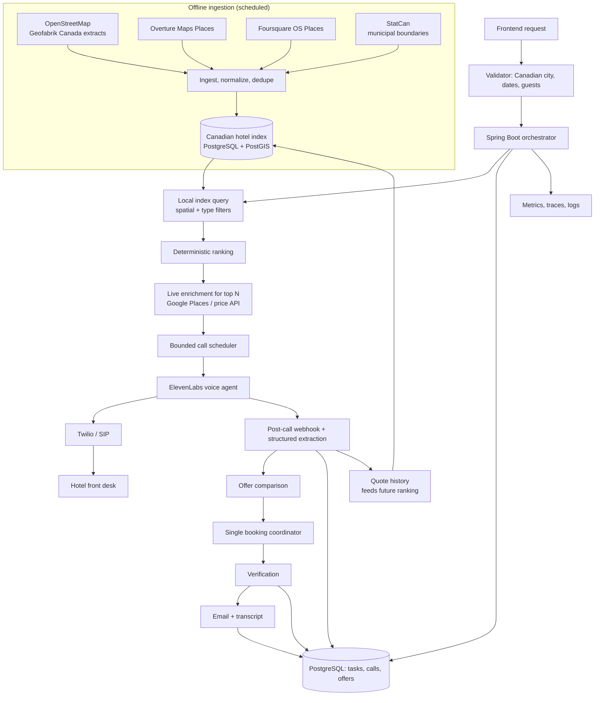

# Hotel Deal Agent

An AI agent that finds the least expensive suitable hotel in any **Canadian** city,
phones the most promising properties, negotiates the lowest permitted direct rate, and emails
the result together with the call transcript.

> **Mission.** Given a destination city anywhere in Canada and stay requirements from the frontend,
> discover and shortlist the cheapest eligible hotels quickly, telephone selected properties,
> negotiate the lowest all-in direct rate, and email the resulting enquiry (or, when
> authorized, reservation) details with the conversation transcript.
>
> **Primary objective.** Minimize the final comparable, mandatory-fee-inclusive stay price;
> then minimize the time to a defensible shortlist and a verified outcome.
>
> **Honesty rule.** A phone enquiry, a verbal quote, a held room and a confirmed booking are
> four different outcomes. The report keeps them apart and does not describe one as another.

---

## What we built on the day

Team 5 built this in one day at the **TechTO Fast & Frugal** hackathon (17 October 2026) and
placed in the **top 4 of 20 teams**. The search covers any city in Canada: the design started
with Ontario, and the organizers opened it to the whole country on the day.

**Team:** Hammed Lawal, Julia Bougaev and Aakash Uma Maheswaran

### The flow



1. **Request.** One natural-language prompt (city and stay dates). GPT-5.4 mini turns it into a
   typed request; Java validates it and rejects cities outside Canada.
2. **Discovery.** Google Places Text Search finds lodging near the city centre at request time
   and stores the results in the local `hotels` table.
3. **Ranking.** `CandidateRanker` sorts the candidates with a fixed comparator: known prices
   and past quotes first, then price tier, phone quality, local number over toll-free, and
   distance from downtown.
4. **Parallel voice calls.** `CallScheduler` phones the top candidates through an ElevenLabs
   agent over Twilio, at most 3 at a time. The agent asks whether the room is available and
   for the all-in price. It is instructed not to book, hold a room or give payment details.
5. **Quote extraction.** Each post-call webhook carries the transcript. GPT-5.4 mini extracts a
   typed offer from it, and `OfferEvaluator` picks the cheapest confirmed-available total.
6. **Email.** One report goes to the organizer inbox: hotel, address, phone number called,
   price, reference number (if given), recordings, transcripts, links to the conversations
   and the number of tokens used.

### The result

In the competition run (Calgary, two nights) the agent screened 12 hotels, called 3 in
parallel and emailed the result about 3.5 minutes after the prompt arrived. The cheapest
confirmed-available stay was CA$200.00. The whole run used 5,541 OpenAI tokens.

### Cost decisions

The event ranked teams by how quickly the result email arrived and how cheap the hotel was.
To keep our own running costs low as well, we used paid AI only where a rule in code could
not do the job.

- **GPT-5.4 mini, used only for structured extraction.** The model does two jobs: it turns
  the prompt into a typed request (`SpringAiTaskPromptInterpreter`), and it turns each call
  transcript into a typed offer (`SpringAiOfferExtractor`). Both use Structured Outputs with
  every field nullable, so the model can return `null` for anything the call did not state
instead of being pushed to fill in a value. Each task
  records its token use (`ai_usage` table), and the email reports the total.
- **Ranking and price comparison are done in Java, not by the model.** `CandidateRanker`
  decides who to call, and `OfferEvaluator` compares `BigDecimal` totals to choose the winner.
  The model does not choose the winner. This saves tokens, gives the same answer for the same
  input, and is covered by unit tests (`CandidateRankerTest`, `OfferEvaluatorTest`).
- **At most 3 parallel calls,** to fit the concurrency limit of our ElevenLabs plan
  (`hotel-agent.policy.max-parallel-calls=3`). Voice calls are billed by the minute, and three
  calls gave us enough quotes to compare in the competition run.
- **Google Places field masks.** Places bills by the fields a request asks for. Every request
  sends an `X-Goog-FieldMask` with only the fields we use (ID, name, address, phone numbers,
  location, business status, and a few ranking hints). Reviews, photos and other fields we
  would not use are left out of the request.

### What is design only

The rest of this README is the design spec we wrote before the event. Some of it describes
what runs today and some of it is the longer-term design. The two largest parts that were not
built are under [Future work](#21-future-work): the open-data hotel index (OpenStreetMap,
Overture, Foursquare) and the starter tuning configuration. The [technology table](#3-technology-choices)
lists what the code uses. The run steps for the event are in
[`docs/RUNBOOK.md`](docs/RUNBOOK.md).

---

## Contents

1. [Scope, requirements and non-goals](#1-scope-requirements-and-non-goals)
2. [Architecture](#2-architecture)
3. [Technology choices](#3-technology-choices)
4. [Canada-specific rules](#4-canada-specific-rules)
5. [End-to-end workflow](#5-end-to-end-workflow)
6. [Discovery and ranking](#6-discovery-and-ranking)
7. [Voice and phone calls](#7-voice-and-phone-calls)
8. [Booking correctness and concurrency](#8-booking-correctness-and-concurrency)
9. [Data model](#9-data-model)
10. [Frontend request contract](#10-frontend-request-contract)
11. [Email, transcript and evidence](#11-email-transcript-and-evidence)
12. [Performance and cost](#12-performance-and-cost)
13. [Security, privacy and compliance](#13-security-privacy-and-compliance)
14. [Observability and metrics](#14-observability-and-metrics)
15. [Testing plan](#15-testing-plan)
16. [Delivery roadmap](#16-delivery-roadmap)
17. [Repository structure](#17-repository-structure)
18. [Getting started](#18-getting-started)
19. [Risks and mitigations](#19-risks-and-mitigations)
20. [Open questions](#20-open-questions)
21. [Future work](#21-future-work)
22. [References](#22-references)

---

## 1. Scope, requirements and non-goals

### Geographic scope

- **Anywhere in Canada.** The destination must resolve to a municipality in any Canadian
  province or territory. Seeded municipalities are matched first, then Google Places finds the
  locality and its province. A city outside Canada (e.g. Seattle) is rejected with a `422`
  and suggestions, not silently searched. When a name exists in several provinces and none is
  given, a seeded Ontario match wins; otherwise the user gets a list of matches to choose from.
- **Currency is CAD.** All comparisons happen in Canadian dollars, so no FX conversion is
  needed on the critical path. A quote in any other currency is flagged and excluded from
  "cheapest" claims.
- **Phone numbers are NANP** (`+1`), normalized to E.164.

### Competition timing and tiebreaker

- Competition timing ends when the result email arrives in the organizer's inbox.
- If two teams finish at the same time, the hotel's distance from downtown of the
  revealed city is the tiebreaker. This is not a maximum-radius restriction.
- The organizer has not yet confirmed a numeric radius, the downtown
  reference point, the measurement method, or which distance wins the tie. Do not
  assume these details; obtain clarification before applying the tiebreaker.

### Required behaviour

- Accept a frontend request with city, stay dates, room/guest counts, destination email,
  constraints and authorization mode. A free-text prompt is optional and is converted to the
  same typed request.
- Validate dates, nights, guests, rooms, constraints, deadline and email; confirm the city is
  in Canada.
- Discover hotels near the city centre. *As built:* Google Places Text Search at request
  time. *Design note:* a pre-loaded open-data index (§21.1) was planned but not built.
- Rank candidates deterministically before calling, so unsuitable or expensive options are
  deprioritized.
- Make real outbound calls through an approved telephony integration.
- Speak naturally, navigate supported IVR menus, ask for the lowest suitable all-in direct
  rate, and confirm conditions.
- Capture structured offer data and retain the transcript.
- Select the cheapest eligible comparable offer; attempt a booking **only** if the user has
  authorized it.
- Verify hotel identity, stay, final quote and expiry, enquiry ID (if given) and reservation
  confirmation (only if actually booked).
- Email a status-specific report with hotel, quote, enquiry ID and transcript; include a
  reservation number only for a real booking.
- Track every stage against the deadline and report honestly if any requirement was not met.

### Non-goals

- No browser automation in the MVP (and none at all if competition rules prohibit it —
  enforce via configuration).
- No turnkey booking agent if prohibited; price APIs are leads only, and the phone
  negotiation is done by this system.
- No scraping of OTAs or hotel sites in violation of their terms.
- Never equate an advertised price, verbal quote or completed call with a confirmed booking.
- Never let several agents independently commit reservations.
- Never use an LLM for arithmetic, hard eligibility rules, concurrency control, ranking or
  authoritative booking state.

### Inputs that must be supplied

Check-in/check-out dates, guest count, room count, destination email, authorization mode,
budget/constraints and deadline. If an essential field is missing, apply a
competition-approved default or fail fast. Never invent a date, identity or guest
requirement. Taxes, fees, cancellation and deposit terms are always recorded explicitly.

---

## 2. Architecture

A **modular monolith**: one Spring Boot application, PostgreSQL with PostGIS, a minimal
Next.js UI, and managed external services. Microservices, Kafka, Kubernetes and a vector
database are not needed for the first working version.

> **Design note.** This diagram is the target design. The "Offline ingestion" box and the
> quote-history feedback loop were not built. At the event, Google Places Text Search filled
> the `hotels` table at request time. See [What we built on the day](#what-we-built-on-the-day)
> for the flow that ran.



### Ownership

| Component | Owns |
|---|---|
| **Spring Boot** | Deadlines, ranking, candidate selection, budgets, concurrency, booking authorization, retries, state transitions, email status |
| **Ingestion job** (*not built*, §21.1) | Building and refreshing the hotel index from open datasets |
| **ElevenLabs** | Speech, turn-taking, natural dialogue, call-level analysis |
| **Telephony** | Outbound dialing, call status, DTMF, call-leg events |
| **PostgreSQL / PostGIS** | Hotel index, candidates, quotes, calls, reservation evidence, webhook idempotency, delivery status |
| **Email provider** | Transport, acceptance, delivery/bounce events, message IDs |

The voice agent receives **one hotel and one clear objective per call**. It does not
discover or select hotels, control deadlines, or authorize bookings.

---

## 3. Technology choices

This table lists what the code uses today. Planned items that were not built are marked
*not built*.

| Capability | In the code | Notes |
|---|---|---|
| Backend | Java 25 + Spring Boot 4.1 | Modular monolith; layer rules enforced by ArchUnit. |
| Database | PostgreSQL 17 + PostGIS 3.5 (`compose.yaml`) | Flyway migrations V1–V10. Testcontainers in integration tests. |
| Hotel discovery | Google Places API (New) Text Search, at request time | Results are written to the local `hotels` table and queried from there. The open-data index is *not built* (§21.1). |
| Phone/identity enrichment | Google Places Place Details with field masks | Verifies the phone number and business status. |
| Price signals | None (`NoPriceProvider`) | No price API was used. The phone quote is the only price. |
| Voice agent | ElevenLabs Agents | One tested agent config plus dynamic variables per call. Prompt in [`docs/voice-agent-prompt.md`](docs/voice-agent-prompt.md). |
| Phone calls | ElevenLabs native Twilio integration | Outbound calls only. No SIP trunk. |
| AI | Spring AI 2.0 + OpenAI `gpt-5.4-mini` | Structured extraction only: prompt → request, transcript → offer. Ranking and arithmetic are done in Java. |
| Webhooks | ElevenLabs post-call webhook, HMAC-verified | Exposed through a cloudflared tunnel during the event (`APP_PUBLIC_BASE_URL`). |
| Async | Virtual threads (`spring.threads.virtual.enabled`) | `CallScheduler` caps active calls per task at 3. |
| Cache | *Not built* | Caffeine was planned; nothing is cached in memory. |
| Email | Gmail SMTP (`spring-boot-starter-mail`, `APP_EMAIL_TRANSPORT=smtp`) | Used at the event. Resend is still supported as a second transport (`APP_EMAIL_TRANSPORT=resend`), but without a verified domain it only delivers to the account owner. |
| Frontend | Next.js 16 static export + React + Tailwind 4 | Packaged into the backend jar and served by Spring Boot at `/`. |
| Observability | Spring Boot Actuator (`/actuator/health`) and per-task token usage | Micrometer metrics and OpenTelemetry tracing are *not built*. |
| Tests | JUnit, Testcontainers, ArchUnit, WireMock, Vitest, Playwright | Run in GitHub Actions. |
| Deployment | One local machine plus a cloudflared tunnel | A hosted deployment in a Canadian region is *not built*. |

### Integration trade-offs

- **ElevenLabs + Twilio.** Start with the official native integration. Test outbound calls to
  Canadian numbers, Canadian caller ID, concurrency, call status, webhook delivery and DTMF.
  Move to SIP trunking only as a deliberate fallback.
- **Google Places.** Always use field masks (e.g. `id,displayName,formattedAddress,
  internationalPhoneNumber,businessStatus`). Respect Google's storage terms: the place ID may
  be stored, most other content may not be cached long-term, so Google data is kept
  separately from the open-data index (§21.1.5).
- **Price APIs.** Public documentation does not mean access. Check registration, approval,
  Canadian coverage, tax handling and commercial-use terms early; developer programs in this
  space change, so verify current availability before depending on one.
- **Spring AI.** Use typed records and schema validation. Never let an LLM calculate totals or
  decide which price is lower.

---

## 4. Canada-specific rules

| Topic | Rule |
|---|---|
| **Currency** | CAD only. |
| **Sales tax** | Each province taxes accommodation differently (GST, HST, PST, QST): from 5% in Alberta and the territories to 15% in New Brunswick, PEI and Newfoundland and Labrador (13% in Ontario and BC, 14.975% in Quebec). The combined rate per province lives in the `Province` enum and is used only to estimate a total when the hotel did not state its taxes. The agent asks whether a quote includes tax; never assume. |
| **Accommodation levies** | Many cities add a municipal or tourism levy (e.g. Ontario's Municipal Accommodation Tax, BC's MRDT, Quebec's lodging tax). Rates differ by city and change, so they are not guessed: the agent asks whether a levy is included, and an estimated total must beat a fully known one by more than 6% to win (`app.pricing.estimate-margin`). |
| **Destination Marketing Fee (DMF)** | Some hotels add a DMF (often described as voluntary). Record it as a separate line and ask whether it can be removed. |
| **Other fees** | Parking, resort fees, pet fees, deposits — ask, record separately, exclude optional ones from the comparable total. |
| **Time zones** | Canada spans six time zones. As built, each province maps to one zone (`Province` enum), which sets "today" and the stay dates. Provinces that span zones (e.g. north-west Ontario, eastern BC, Nunavut, Labrador) should derive the zone from the hotel's coordinates; that is not built. |
| **Calling hours** | Only call within configurable local business hours for the hotel's time zone (front desks are usually 24/7, but reservations offices may not be). |
| **Language** | English by default. Configure a French-capable agent voice for Quebec and other francophone areas (e.g. parts of New Brunswick, Ontario and Manitoba) if the receptionist switches language. |
| **Phone numbers** | Prefer the property's local number over chain toll-free numbers (`800/833/844/855/866/877/888`), which usually reach central reservations rather than the front desk that can negotiate. |
| **Recording and privacy** | Announce at the start of each call that it is an AI assistant and that the call is recorded/transcribed. Handle personal information under PIPEDA. Confirm the applicable rules for automated calls (CRTC Unsolicited Telecommunications Rules) with the organizers before live calling. |
| **City validation** | Accept any Canadian municipality, including common aliases (e.g. "the Soo" → Sault Ste. Marie) and typos that Google Places can resolve. A named province is respected ("Windsor, Nova Scotia" does not resolve to Windsor, Ontario). Names that exist both in and outside Canada (e.g. London) resolve to Canada because of the scope; if a name matches several Canadian municipalities and no province is given, the seeded Ontario match wins, otherwise the user gets the list of matches to choose from. |

---

## 5. End-to-end workflow

### State machine

```text
RECEIVED
  -> VALIDATING
  -> DISCOVERING
  -> RANKING
  -> CALLING_FOR_QUOTES
  -> OFFER_SELECTED
  -> BOOKING            (only if authorized)
  -> VERIFYING
  -> EMAIL_PENDING
  -> COMPLETED

Terminal / recovery states:
INVALID_REQUEST, OUT_OF_SCOPE_LOCATION, NO_CANDIDATES, NO_VALID_OFFER,
BOOKING_UNCERTAIN, BOOKING_FAILED, EMAIL_FAILED, DEADLINE_EXCEEDED
```

### Steps

1. **Validate** the request into a typed `BookingTask`: Canadian municipality, dates, nights,
   rooms/guests, email, deadline.
2. **Start the clock**: monotonic elapsed time plus wall-clock timestamps.
3. **Discover** with Google Places Text Search, store the results, then query them with PostGIS.
   (*Design note:* a pre-built local index would make this a single query; see §21.1.)
4. **Rank** deterministically (§6).
5. **Enrich** only the top N candidates in parallel, with strict timeouts.
6. **Call a small batch** of the highest-ranked candidates as soon as the first one is
   verified — do not wait for all enrichment to finish.
7. **Capture offers** as each call completes.
8. **Decide whether to continue**, comparing the best verified offer with remaining
   candidates and time left.
9. **Book once** (if authorized) through the single booking coordinator.
10. **Verify** the reservation, terms and written-confirmation status.
11. **Email** the report and transcript; track provider acceptance and delivery.
12. **Finalize**: store final status and timings; report missing requirements as missing.

### Deadline management

Split the overall deadline into a discovery window, a parallel quote window and a protected
finalization window, tuned from benchmark data. A timed-out request is not necessarily a
failed booking — a lost response can happen after the hotel created a reservation, so
reconcile before retrying any commit.

---

## 6. Discovery and ranking

### Candidate fields

Canonical hotel ID and source IDs · name, address, municipality, coordinates · phone(s),
phone confidence, local/toll-free · website · property type, stars, brand, brand tier ·
price signal (source, amount, nightly vs. total, taxes included?, retrieved at) · quote
history summary · eligibility and exclusion reasons · call priority.

### Critical path

1. Apply hard filters in SQL: inside the municipality (or within a configured radius), allowed
   property types, not closed, has at least one phone number.
2. Apply user constraints: budget ceiling (when a price signal exists), required amenities
   (when known — unknown is not a rejection).
3. Rank (below). Enrich and verify phone numbers for the top N only.
4. Start the first call as soon as one candidate is verified. Keep ranking and enriching while
   calls run.
5. Keep a small **exploration lane** for independent hotels with no price signal; size it from
   measured quote yield, not intuition.
6. Before closing a viable negotiation, ask for a final discount.
7. Stop when the deadline or expected-benefit threshold is reached. Report how many
   candidates were screened, called and not called.

The output is **the cheapest comparable offer found among the hotels checked**, never a
guaranteed citywide cheapest.

### Ranking model

Most open-data candidates have no live price, so ranking combines a few deterministic
signals:

```text
call_order = (
    eligible_first,
    known_all_in_total_ascending,        # live price signal, if any
    quote_history_median_ascending,      # our past phone quotes
    price_tier_ascending,                # derived from type, stars, brand tier
    phone_confidence_descending,
    local_number_first,                  # front desk over central reservations
    distance_to_city_centre_ascending
)
```

`price_tier` is a simple lookup: motel / guest house / economy brand → 1, midscale → 2,
upscale → 3, luxury / resort → 4. The brand-tier table is maintained by hand and keyed on
`brand:wikidata`.

This is a scheduling heuristic, not the winner calculation. The winner is the lowest
comparable, eligible, currently obtainable negotiated total among offers actually received.

### Cost normalization

```text
comparable_total =
    sum(nightly room rates)
  + sales tax (GST / HST / PST / QST)
  + accommodation levy (if charged)
  + mandatory property / resort / DMF fees (if not removable)
  + mandatory booking fees
```

Store the original quote and the normalized total. Represent unknown components explicitly
(`taxesIncluded = UNKNOWN`). Never mix a nightly rate with a stay total. Use `BigDecimal`
with fixed scale; never floating point. Flag optional fees, refundable deposits and
pay-at-property charges separately. An offer with unknown taxes is a lead, not a definitive
"cheapest".

---

## 7. Voice and phone calls

### Conversation objectives

1. Identify as an AI assistant calling on behalf of a guest; state that the call is recorded.
2. Ask for the front desk or reservations.
3. State dates, rooms, guests and key requirements clearly.
4. Ask whether the exact stay is available and for the lowest **all-in** direct rate,
   including sales tax, any accommodation levy and any mandatory fees.
5. Politely ask about any genuinely applicable discount (direct-booking, advance-purchase,
   extended-stay, manager-approved) without misrepresenting eligibility.
6. Cite a competing quote **only** if it is real, verified, and the user allowed disclosure.
7. Counter-offer only within configured limits; ask once for the best final price; stop after
   a bounded number of exchanges.
8. Read back property, dates, room type, occupancy, total, currency, taxes/fees, cancellation
   and deposit terms, validity period and whether the room is held. Ask for an
   enquiry/reference ID.
9. End politely if unavailable, too expensive, or unable to proceed.

The agent must never invent competing quotes, pretend to be human, fabricate an identity or
payment card, read out card details, or agree to unapproved charges or terms.

### IVR and hold handling

- DTMF when supported; listen, choose the relevant department, stop after a bounded number of
  failed menu attempts.
- Configurable ring, silence and hold cutoffs; no infinite hold loops.
- Voicemail detection only if the chosen path exposes it reliably.
- No aggressive redialing; follow call etiquette and competition rules.

### Structured outcome (illustrative)

```json
{
  "callOutcome": "OFFER_RECEIVED",
  "hotelName": "Example Inn",
  "availabilityConfirmed": true,
  "checkIn": "YYYY-MM-DD",
  "checkOut": "YYYY-MM-DD",
  "roomType": "Queen room",
  "guestCount": 2,
  "currency": "CAD",
  "roomSubtotal": 200.00,
  "hst": 26.00,
  "municipalAccommodationTax": null,
  "mandatoryFees": 0.00,
  "taxesIncludedInQuote": "UNKNOWN",
  "totalPrice": 226.00,
  "cancellationTerms": "Free cancellation until ...",
  "depositTerms": null,
  "enquiryId": "ENQ-12345",
  "initialQuotedTotal": 249.00,
  "negotiatedTotal": 226.00,
  "quoteValidUntil": null,
  "reservationCreated": false,
  "confirmationNumber": null,
  "writtenConfirmationSent": false,
  "evidenceStatus": "VERBAL_ONLY",
  "failureReason": null
}
```

Missing values are `null` or `UNKNOWN`, never invented. Java validates every field and
re-computes the total against the requested stay.

### Webhooks

Use ElevenLabs post-call transcription/analysis webhooks. Verify signatures, persist events
idempotently (providers retry), tolerate out-of-order arrival, and keep call-initiation
failures separate from completed calls.

---

## 8. Booking correctness and concurrency

This is the highest-risk part of the system.

### Authorization modes

| Mode | Behaviour |
|---|---|
| `ENQUIRY_ONLY` (default) | Call, negotiate, obtain a reference ID, report. Never ask the hotel to commit a reservation or take a deposit. |
| `REQUIRE_APPROVAL` | Capture quotes, then wait for the user's approval before any booking. |
| `BOOK_IF_WITHIN_LIMITS` | Book only if the user authorized the exact dates, occupancy, maximum CAD total, payment and cancellation policy, and an approved payment method exists. |

No payment method means no claim of a paid booking. Card details are never collected or
transcribed by the voice agent; use a PCI-compliant handoff if payment is required.

### Quote stage vs. booking stage

- **Quote stage:** concurrent calls ask for prices and terms without reserving.
- **Booking stage:** one central coordinator authorizes one reservation attempt, guarded by a
  database lock / unique constraint on `(task_id)` in `reservations`.
- If a hotel will only hold a price by booking immediately, classify the offer as a
  commitment risk and follow an explicit policy.

### Outcomes and reservation states

Task outcomes: `ENQUIRY_COMPLETED`, `QUOTE_RECEIVED`, `BOOKING_CONFIRMED`,
`NO_ELIGIBLE_HOTELS`, `NO_VALID_QUOTE`, `FOLLOW_UP_REQUIRED`, `CALL_FAILED`,
`BOOKING_UNCERTAIN`, `EMAIL_FAILED`, `DEADLINE_EXCEEDED`.

Reservation states: `NOT_ATTEMPTED`, `ATTEMPT_IN_PROGRESS`, `CONFIRMED`, `FAILED`,
`UNCERTAIN`, `CANCELLED`.

`enquiry_id` and `confirmation_number` are separate nullable fields. If a call drops after
the receptionist may have booked, mark `UNCERTAIN` and reconcile (transcript, confirmation
email, call-back) before any retry. Never auto-cancel without authorization.

### Verification checklist (bookings)

Correct hotel and full address · correct dates · correct room and guests · real confirmation
number · CAD total with tax/fee status · cancellation and payment terms · hotel-issued
written confirmation, or a clearly stated limitation · final email sent.

A summary generated by this app is **not** a hotel-issued receipt and is never labelled as one.

---

## 9. Data model

| Table | Core fields |
|---|---|
| `municipalities` | id, name, province, aliases, census subdivision code, boundary (geometry), time zone, MAT rate + effective date |
| `hotels` | id, canonical name, address, municipality_id, location (geography), property type, stars, brand, brand tier, phones (ranked), website, phone confidence, status, last_seen_at |
| `hotel_source_records` | hotel_id, source (`OSM`/`OVERTURE`/`FSQ`/`WIKIDATA`), source ID, raw tags (jsonb), licence, retrieved_at |
| `hotel_enrichments` | hotel_id, provider (`GOOGLE_PLACES`, price API), place_id, verified phone, business status, payload, expires_at |
| `booking_tasks` | id, request hash, request_id (unique), municipality_id, dates, guests, rooms, email, deadline, authorization_mode, status, timings |
| `hotel_candidates` | task_id, hotel_id, price signal, call priority, exclusion reason |
| `hotel_offers` | task_id, hotel_id, initial quote, negotiated total, room subtotal, sales tax, accommodation levy, fees, currency, enquiry_id, expiry, terms, evidence |
| `quote_history` | hotel_id, stay dates, nights, occupancy, room type, comparable total, quoted_at |
| `phone_calls` | task/hotel IDs, provider call ID (unique), ElevenLabs conversation ID (unique), status, start/end, duration, failure reason |
| `transcripts` | call_id, transcript or object-storage reference, structured extraction, retention expiry |
| `reservations` | task_id (unique), hotel_id, confirmation number, total, currency, state, evidence source |
| `email_deliveries` | task_id, provider message ID, recipient, status, sent/delivered/bounced timestamps |
| `webhook_events` | provider, external event ID (unique), received/processed time, status |

Use foreign keys, GiST indexes on geometry columns, Flyway migrations and idempotent webhook
processing. Never log secrets or payment data.

---

## 10. Frontend request contract

*As built*, the UI is one free-text prompt (`POST /api/tasks/prompt`). GPT-5.4 mini turns it
into a typed request, and the backend validates it. The structured endpoint (`POST
/api/tasks`) takes typed fields directly; the record below is the design version. The city can be anywhere in Canada; a province
in the prompt narrows the match. `requestId` is generated client-side for
deduplication. Authorization defaults to `ENQUIRY_ONLY`. Stay dates are in the hotel's local
time zone; `deadline` is an absolute timestamp.

```java
public record BookingTaskRequest(
    String city,                 // must resolve to a Canadian municipality
    LocalDate checkIn,
    LocalDate checkOut,
    int rooms,
    int adults,
    int children,
    String destinationEmail,
    Instant deadline,
    Set<String> requiredAmenities,
    AuthorizationMode authorizationMode,
    BigDecimal maximumTotalCad,
    boolean allowCompetingQuoteDisclosure,
    String requestId
) {}
```

Validation: city in Canada, `checkOut > checkIn`, check-in not in the past, positive
rooms/adults, valid email, deadline in the future.

Example prompt (for the optional free-text box):

> Find the cheapest suitable hotel in Halifax, Nova Scotia for one room, two adults, checking in
> on *date* and out on *date*. Compare all-in totals including sales tax and any accommodation
> levy, call the most promising hotels, politely negotiate a direct rate, and
> email the result and the call transcript to *email* before *deadline*. Do not book.

Never use sample dates or addresses in a real call.

---

## 11. Email, transcript and evidence

Two separate requirements:

1. **Hotel-originated confirmation:** ask the hotel to send its confirmation/receipt to the
   supplied email; record it if they cannot.
2. **Agent report:** send the result fields and transcript to the same address.

### Default template (replace if a required template is supplied)

```text
Subject: Hotel negotiation result — {{city}}, {{province}} — {{checkIn}} to {{checkOut}}

Hello,

Here is the result of your hotel-rate enquiry.

Status: {{outcome}}
Hotel: {{hotelName}}
Address: {{hotelAddress}}
Phone: {{hotelPhone}}
Stay: {{checkIn}} to {{checkOut}} | {{rooms}} room(s) | {{guests}} guest(s)
Room type: {{roomTypeOrUnknown}}
Initial phone quote: {{initialQuoteOrUnknown}}
Best negotiated all-in total (CAD): {{bestTotalOrUnknown}}
Savings versus initial phone quote: {{savingsOrUnknown}}
Taxes and fees (sales tax / levy / other): {{feeDetails}}
Cancellation / payment terms: {{termsOrUnknown}}
Offer expiry: {{expiryOrUnknown}}
Hotel enquiry/reference ID: {{enquiryIdOrNotProvided}}
Reservation confirmation #: {{confirmationOrNotBooked}}
Hotel-issued confirmation: {{receiptStatus}}
Verification status: {{verificationStatus}}
Hotels screened / called: {{screenedCount}} / {{calledCount}}

Conversation transcript:
{{transcriptTextOrSecureLink}}

Important: an enquiry ID or negotiated quote is not a confirmed booking.
{{nextStepWhenNotBooked}}

Hotel data © OpenStreetMap contributors, Overture Maps Foundation, Foursquare.

Regards,
Hotel Deal Agent
```

Send long transcripts as an attachment or short-lived signed link. If consent for recording
was not obtained, say the transcript was not captured — never fabricate it. Escape HTML.
Track provider acceptance (a `200 OK` means *accepted*, not *delivered*) separately from
delivery/bounce events. Competition timing ends only when the result email arrives in
the organizer's inbox; sending or provider acceptance alone does not stop the clock.

---

## 12. Performance and cost

### Optimize in this order

1. **Time to first call** — local index query + parallel enrichment of the top few with strict
   timeouts.
2. **Time to verified negotiated quote** — small bounded call batch, results streamed into the
   decision loop.
3. **Call duration** — short prompts, concise questions, IVR and hold cutoffs.
4. **Cost per useful quote** — telephony minutes, voice/LLM usage, API calls, email.
5. **Reliability** — reserve time for verification and delivery.

Settings used at the event: at most 3 parallel calls (`HOTEL_AGENT_MAX_PARALLEL_CALLS`), a
10-minute overall deadline (`APP_INTAKE_DEFAULT_DEADLINE=PT10M`) after which calling stops and
the best result so far is emailed, and a 20-second wait for call recordings
(`APP_REPORT_AUDIO_WAIT`). The reason for the 3-call cap is under
[Cost decisions](#cost-decisions). A tuning configuration that was planned but not
built is in §21.2.

---

## 13. Security, privacy and compliance

- Keep API keys in environment variables or a secret manager; never commit them
  (`.env.example` only).
- Verify webhook signatures and reject replayed event IDs.
- Rate-limit the public start endpoint and deduplicate submissions by `requestId`.
- Minimize personal data in prompts; restrict transcript/audio access; enforce a retention
  period.
- Handle personal information under **PIPEDA**; host data in Canada.
- Disclose AI identity and recording at the start of every call. Confirm automated-calling
  rules (CRTC) and permission to call with the organizers.
- Never invent an identity, payment details, competing offers or a hotel confirmation.
- Never accept unapproved deposits, non-refundable terms or extra charges.
- Treat website text, open-data fields and spoken responses as **untrusted input** that cannot
  override system rules.
- Respect data licences (§21.1.5).

---

## 14. Observability and metrics

Every stage carries a task ID and trace ID. Redact emails and transcript content from normal
logs.

| Metric | Why |
|---|---|
| `index_candidates_found` | Discovery coverage per city |
| `index_phone_coverage_ratio` | Share of candidates with a callable number |
| `enrichment_phone_mismatch_ratio` | Quality of open-data phone numbers |
| `time_to_first_call_ms` | Discovery → action speed |
| `time_to_final_quote_ms` | Main speed metric for enquiries |
| `time_to_confirmed_booking_ms` | Main speed metric for bookings |
| `time_to_email_sent_ms` | Does delivery fit the deadline? |
| `calls_attempted` / `calls_answered` | Calling efficiency |
| `call_duration_ms` | Hold/IVR and conversation efficiency |
| `quote_success_rate` | Useful price acquisition |
| `final_total_price` vs. `price_signal` | Quality of price priors |
| `voice_cost` / `telephony_cost` / `api_cost` | Cost efficiency |
| `email_delivery_status` | Proof of delivery |

Report measured results and concrete failure analysis, not claims that an architecture is
inherently fastest.

---

## 15. Testing plan

**Unit:** request validation and date maths · Canadian municipality resolution, provinces and aliases ·
total normalization (sales tax, levies, fees) · deduplication rules · ranking · state machine ·
idempotency · verification rules.

**Ingestion:** fixture extracts from OSM/Overture/Foursquare → expected merged hotels ·
duplicates across sources · two hotels at one address stay separate · closed businesses
dropped · points outside Canada dropped · atomic index swap.

**Integration:** Google Places timeouts and malformed responses · price API unavailable ·
ElevenLabs call start success/failure · duplicate and out-of-order webhooks · email
accepted/bounced/delayed/failed · PostgreSQL uniqueness and locking.

**Voice scenarios:** offer received · IVR with keypad · no answer / busy / voicemail · long
hold · sold out · nightly price quoted without tax or levy · different room or dates offered ·
cannot email a receipt · unclear confirmation number · call drops after possible booking ·
hotel asks for card details · hotel asks "are you a robot?" · receptionist switches to French.

**Rehearsals:** simulated competitions with fixed candidate sets and mocked call outcomes,
then permitted real test calls before competition day. No real bookings for load testing
unless explicitly authorized.

---

## 16. Delivery roadmap

| Phase | Deliverables |
|---|---|
| **1 — Skeleton** | Spring Boot app, PostgreSQL + PostGIS, Flyway, request DTO, state machine, deadline manager, minimal Next.js form and progress view, mock call adapter. |
| **2 — Hotel index** (*not built*, see §21.1) | Municipal boundaries, OSM + Overture (+ Foursquare) ingestion, dedupe, phone normalization, index swap. Measure coverage per benchmark city. |
| **3 — Ranking and enrichment** | Deterministic ranking, Google Places verification for the shortlist, optional price API. |
| **4 — Voice** | ElevenLabs agent + Twilio/SIP, test calls to Canadian numbers, tuned prompt, structured outcomes, verified webhooks. |
| **5 — Booking safety** | Quote/booking separation, central lock, `UNCERTAIN` state, reconciliation; test duplicate and lost-response cases. |
| **6 — Email and evidence** | Transactional email, transcript storage, delivery webhooks, final report. |
| **7 — Benchmark and freeze** | Timed end-to-end runs, tuning, dependency/provider freeze, judge-facing summary of architecture, metrics and lessons. |

---

## 17. Repository structure

One repository, one Maven build, one deployable. The frontend and backend stay separate
source modules (different toolchains, with the HTTP API as the only contract between them),
but the root build packages the Next.js static export into the Spring Boot jar, so one process
serves the UI at `/` and the API at `/api/**` from the same origin.

```text
hotel-reservation-agent-team5/
├── pom.xml                         # root aggregator: open this folder in IntelliJ
├── mvnw, mvnw.cmd, .mvn/           # Maven wrapper (use from the root)
├── backend/                        # Spring Boot 4.1, Java 25
│   ├── pom.xml                     # depends on the frontend module (runtime)
│   ├── compose.yaml                # PostGIS for local dev (multi-arch image)
│   └── src/
│       ├── main/java/com/reservationagent/hotelreservationagent/
│       │   ├── domain/             # pure model, one sub-package per model (no framework)
│       │   ├── application/        # use cases, ports, deterministic business rules
│       │   ├── infrastructure/     # PostgreSQL/PostGIS, WebClient API clients, Spring AI
│       │   ├── presentation/       # REST controllers, DTOs, webhooks, SSE, web config
│       │   └── config/             # Spring wiring
│       ├── main/resources/db/migration/   # Flyway
│       └── test/java/.../          # architecture/, integration/ (*IT), unit/ (*Test), support/
├── frontend/                       # Next.js 16 (App Router), TypeScript, Tailwind
│   ├── pom.xml                     # builds the static export (Node downloaded by Maven)
│   └── src/
│       ├── app/                    # routes and layouts
│       ├── components/             # UI components
│       ├── models/                 # API types
│       └── services/               # API client
├── e2e/                            # Playwright tests against the packaged jar
├── docs/                           # RUNBOOK.md (event run steps), voice-agent-prompt.md
├── .github/workflows/ci.yml
├── .env.example
└── README.md
```

Layer rules are enforced by `ArchitectureTest` (ArchUnit). Provider integrations sit behind small
interfaces (`HotelIndex`, `HotelEnrichmentProvider`, `HotelPriceProvider`, `VoiceCallProvider`,
`EmailProvider`), so providers can be swapped without touching the orchestrator.

---

## 18. Getting started

Requirements: JDK 25+, Docker running. Node is only needed for frontend hot reload; the Maven
build downloads its own copy.

```bash
cp .env.example .env                  # API keys (all optional for local dev)

./mvnw verify                         # build frontend + backend, run all tests
./mvnw install -DskipTests            # build once so the backend has the UI on its classpath
./mvnw -pl backend spring-boot:run    # http://localhost:8080 serves UI + API; PostGIS starts automatically
```

**IntelliJ:** open the repository root (not `backend/`); the root `pom.xml` imports both modules.
Run `HotelReservationAgentApplication` from the backend module.

**Frontend hot reload:** with the backend running, `cd frontend && npm ci && npm run dev` serves
the UI on http://localhost:3000 and proxies `/api/*` to `http://localhost:8080` (`BACKEND_URL`).

**Production artifact:** `./mvnw package` produces `backend/target/hotel-reservation-agent-*.jar`
containing the UI. Provide the database through `SPRING_DATASOURCE_*` environment variables.

---

## 19. Risks and mitigations

| Risk | Mitigation |
|---|---|
| Open data is incomplete or outdated (missing hotels, wrong phones, closed properties) | Combine three sources; cross-source phone agreement score; verify shortlist with Google Places; drop `date_closed`; refresh weekly. |
| No price in open data | Use quote history, price tiers and an optional price API for ranking; the phone call is the authoritative price. |
| Toll-free numbers reach central reservations | Prefer local numbers; record which number type produced better quotes. |
| Licence violation | Keep Google data separate with expiry; attribute OSM/Overture/Foursquare; do not publish the merged OSM-derived database. |
| Quotes omit sales tax or levies | The agent prompt asks about taxes and levies; unknown taxes excluded from "cheapest" claims. |
| Too many calls increase latency/cost | Bounded concurrency, deadline, ranking. |
| Two calls create two reservations | Quote/booking separation; one coordinator; DB uniqueness. |
| Call drops after booking | Mark `UNCERTAIN`; reconcile before retrying. |
| AI hallucinates confirmation details | Structured fields, Java validation, real evidence required. |
| Email accepted but not delivered | Track delivery/bounce webhooks. |
| Provider access not approved | Test credentials early; the open-data index removes the dependency for discovery. |
| Webhook duplicates / late arrival | Signature checks, unique event IDs, idempotent processing. |
| Transcript privacy | Minimize collection, restrict access, retention controls, Canadian hosting. |

---

## 20. Open questions

- **Email template:** none has been supplied yet; replace the default in §11 when it arrives.
- **Booking vs. enquiry:** confirm whether the system should only negotiate and report, or
  create a real booking after approval. The MVP defaults to `ENQUIRY_ONLY`.
- **Competition rules:** confirm restrictions on one-prompt input, calling, booking and browser
  automation; do not treat this README's assumptions as organizer rules.
- **Calling rules:** confirm CRTC/automated-calling requirements and permission to call Canadian
  hotels with an AI agent.
- **Provider access:** confirm ElevenLabs/Twilio Canadian calling, caller ID and concurrency;
  whether any price API is available.
- **Property types:** confirm whether hostels, B&Bs and serviced apartments count as "hotels".

---

## 21. Future work

These parts of the design were written before the event and not built. They are kept here
as design notes for a later version.

### 21.1 Open-data hotel index (not built)

The original design relied on commercial APIs for the hotel list. This section replaces that
with **open datasets** that can be downloaded, combined and queried locally, keeping
commercial APIs only for targeted live enrichment.

#### 21.1.1 Recommended sources

| Source | What it provides | Licence | How to get it | Role |
|---|---|---|---|---|
| **OpenStreetMap** | Hotels, motels, guest houses, hostels, B&Bs with name, address, coordinates and often `phone`, `website`, `stars`, `rooms`, `brand` | ODbL 1.0 | Bulk: Geofabrik Canada extracts (one PBF per province/territory, updated daily). Ad-hoc: Overpass API. | **Primary** property list |
| **Overture Maps — Places** | POIs with categories, addresses, phones, websites, brand and a confidence score | CDLA-Permissive-2.0 (check each release's attribution notes) | GeoParquet on S3/Azure; query with DuckDB using a Canada bounding box | **Primary** — strong phone/website coverage |
| **Foursquare Open Source Places** | POIs with categories, `tel`, `website`, `email`, address and `date_closed` | Apache 2.0 | Parquet files (public bucket / Hugging Face) | Secondary — phone numbers, closed-business filter |
| **Wikidata** | Hotel entities, brand/chain relationships (`brand:wikidata` in OSM) | CC0 | SPARQL endpoint / dumps | Optional — map brands to price tiers |
| **Statistics Canada** (plus provincial portals such as Ontario GeoHub) | Municipal (census subdivision) boundaries and names | Open Government Licence – Canada (provincial equivalents) | Shapefile / GeoJSON download | City validation and "inside this municipality" filter |

> None of these sources include room prices or availability. They answer **"which hotels
> exist here and how do I phone them?"** The phone call answers **"what does it cost?"**

#### 21.1.2 Accommodation types to ingest

| OSM tag | Overture / Foursquare category (approx.) | Default |
|---|---|---|
| `tourism=hotel` | hotel | included |
| `tourism=motel` | motel | included |
| `tourism=guest_house` | guest house, bed and breakfast, inn | included |
| `tourism=hostel` | hostel | configurable (shared rooms rarely match the stay) |
| `tourism=apartment` | serviced apartment | configurable |
| — | resort, lodge | configurable |
| `tourism=camp_site`, `caravan_site` | campground | excluded |

Exact category keys differ between Overture and Foursquare releases; keep the mapping in a
config file (`ingestion/category-map.yml`) rather than in code.

#### 21.1.3 Ingestion pipeline

Run weekly (or nightly during the competition window); the job is idempotent.

1. **Download** the Geofabrik Canada PBFs, then filter it with `osmium tags-filter` to
   `tourism=hotel,motel,guest_house,hostel,apartment`.
2. **Query** Overture and Foursquare Parquet with DuckDB, limited to the Canada bounding box
   and accommodation categories; drop Foursquare rows with `date_closed` set.
3. **Clip** every point to the Canada polygon and attach the containing municipality from
   the boundary file (PostGIS `ST_Contains`).
4. **Normalize**: E.164 phone numbers (libphonenumber, region `CA`), lower-cased domains,
   Canada Post-style address formatting, accent-insensitive name keys.
5. **Deduplicate and merge** (§21.1.4) into one canonical `hotels` row per property, keeping
   every source record in `hotel_source_records` for provenance.
6. **Score data quality**: `phone_confidence` (how many sources agree on the number),
   `last_seen_at`, and whether the number is local or toll-free.
7. **Publish** atomically (load into a staging table, then swap) so a running task never sees
   a half-loaded index.

Example ad-hoc Overpass query for one city (Ottawa; for development, not bulk loading — respect the public
instance's usage policy):

```overpassql
[out:json][timeout:60];
area["ISO3166-2"="CA-ON"]->.on;
area["name"="Ottawa"]["boundary"="administrative"](area.on)->.city;
nwr["tourism"~"^(hotel|motel|guest_house)$"](area.city);
out center tags;
```

#### 21.1.4 Deduplication rules

Match records into one property when **any** of these hold, in order of strength:

1. Same OSM ID / Overture ID / Foursquare ID referenced across datasets.
2. Same normalized phone number **and** within 250 m.
3. Same website domain **and** within 250 m (chain domains excluded — they are shared).
4. Name similarity ≥ 0.85 (Jaro-Winkler on normalized names) **and** within 100 m.

Never merge two records with different street numbers, or two different brands at the same
address (e.g. two hotels in one complex). When sources disagree on the phone number, keep
all numbers ranked by agreement and recency; the top candidates are verified with Google
Places before calling.

#### 21.1.5 Licensing and attribution

- **OSM (ODbL):** credit "© OpenStreetMap contributors" in the UI and docs. If the merged
  database is ever *published*, the derived OSM portion must be shared under ODbL. Internal
  use only does not trigger share-alike.
- **Overture:** follow the attribution file shipped with each release.
- **Foursquare OS Places:** Apache 2.0 — keep the licence notice.
- **Google Places:** **do not** copy Google content into the open-data `hotels` table. Store
  only the `place_id` plus short-lived enrichment in `hotel_enrichments` with an expiry, as
  Google's terms require.
- Record source, licence and retrieval time on every source record.

#### 21.1.6 Live enrichment (only for the shortlist)

For the top `phone_enrichment_limit` candidates:

- **Google Places Place Details** — confirm the phone number, `businessStatus`
  (`OPERATIONAL`), and formatted address.
- **Optional price API** — date-specific rate as a ranking hint, if access exists.
- **Hotel website** (via a search API with a documented contract) — rate clues only, never
  proof of availability.

#### 21.1.7 Our own quote history

Every phone quote is stored with hotel, dates, occupancy, room type and total. Over time this
becomes the best price prior for Canadian properties (e.g. "this motel quoted $119–$139 all-in
for a weekday double"). The ranking engine uses it as a signal, never as a live quote.

### 21.2 Starter configuration for tuning (not built)

```properties
discovery.radius-km=15
enrichment.timeout-ms=2500
enrichment.phone-limit=6
calls.max-parallel=2
calls.max-negotiation-rounds=2
calls.max-duration-seconds=240
deadline.reserve-seconds=45
```

Benchmark on a repeatable set of Canadian cities (e.g. Toronto, Montréal, Vancouver, Calgary,
Halifax, Winnipeg, Thunder Bay) and dates: discovery latency (median/p95), time
to first call, time to final quote, negotiated vs. best observed quote, % of quotes with all
fees known, cost per useful quote, and rate of duplicate/uncertain reservations.

---

## 22. References

**Open hotel data and geography**
- OpenStreetMap — <https://www.openstreetmap.org> · tagging: <https://wiki.openstreetmap.org/wiki/Key:tourism>
- Geofabrik Canada extracts — <https://download.geofabrik.de/north-america/canada.html>
- Overpass API — <https://wiki.openstreetmap.org/wiki/Overpass_API>
- Overture Maps (Places) — <https://docs.overturemaps.org>
- Foursquare Open Source Places — <https://docs.foursquare.com/data-products/docs/access-fsq-os-places>
- Wikidata Query Service — <https://query.wikidata.org>
- Ontario GeoHub — <https://geohub.lio.gov.on.ca>
- Statistics Canada boundary files — <https://www12.statcan.gc.ca/census-recensement/2021/geo/sip-pis/boundary-limites/index-eng.cfm>
- ODbL licence — <https://opendatacommons.org/licenses/odbl/>

**Voice and telephony**
- ElevenLabs Agents — <https://elevenlabs.io/docs/agents-platform/overview>
- ElevenLabs Twilio integration, SIP trunking, post-call webhooks — see the ElevenLabs docs
- Twilio Voice API — <https://www.twilio.com/docs/voice>

**Enrichment and pricing**
- Google Places API (New) — <https://developers.google.com/maps/documentation/places/web-service>
- Expedia Group Rapid API — <https://developers.expediagroup.com/rapid>

**Backend, AI and observability**
- Spring Boot — <https://spring.io/projects/spring-boot> · Spring AI — <https://docs.spring.io/spring-ai/reference/>
- PostgreSQL — <https://www.postgresql.org/docs/> · PostGIS — <https://postgis.net/documentation/>
- OpenTelemetry Java — <https://opentelemetry.io/docs/languages/java/>

**Email**
- Resend — <https://resend.com/docs>

**Canadian rules**
- PIPEDA — <https://www.priv.gc.ca/en/privacy-topics/privacy-laws-in-canada/the-personal-information-protection-and-electronic-documents-act-pipeda/>
- CRTC Unsolicited Telecommunications Rules — <https://crtc.gc.ca/eng/trambts.htm>

Provider features, pricing, licences and access rules change — verify against current
documentation before implementation.

---

## Final recommendation

Build a **Spring Boot modular monolith + PostgreSQL/PostGIS + ElevenLabs Agents + Twilio +
email**, with Google Places for discovery now and an open-data hotel index later (§21.1).

The competitive advantage is the orchestration policy: find candidates quickly, filter
and rank deterministically, verify a short list, call a bounded number of hotels, compare
verified all-in CAD totals, authorize at most one booking, and reserve time to verify and
email proof. "Cheapest" means the lowest comparable price found and verified — not a guarantee
about every hotel in the city.
