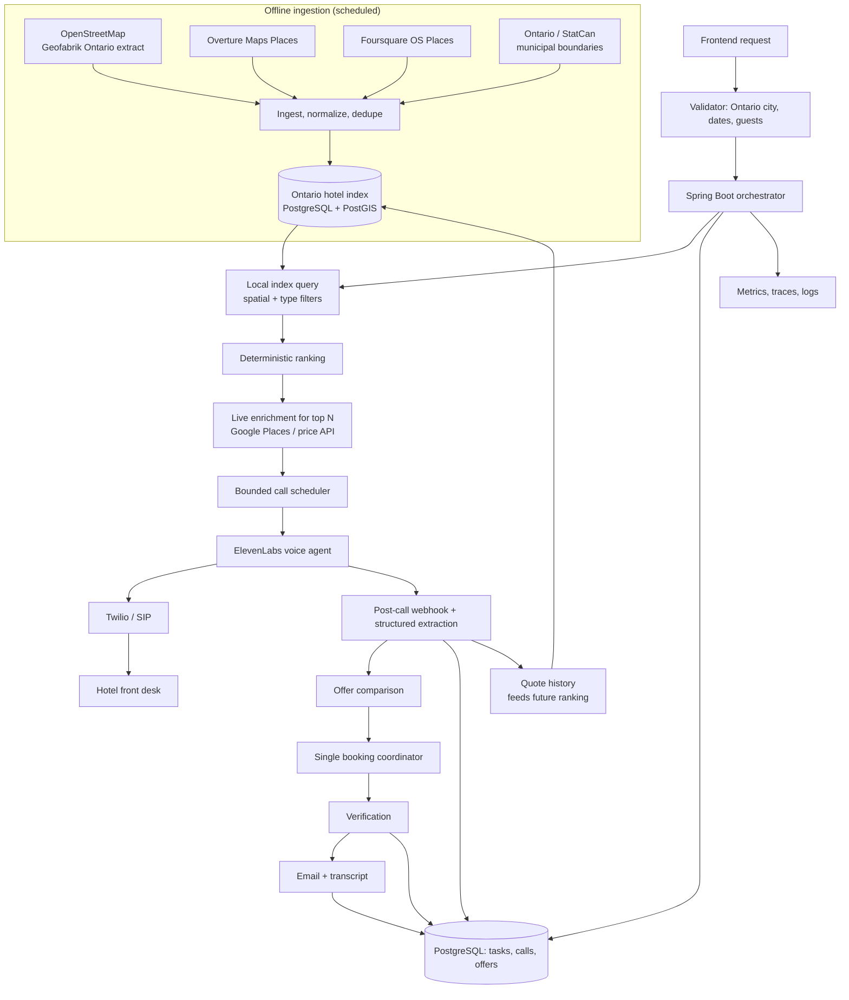

# Hotel Deal Agent

An AI agent that finds the least expensive suitable hotel in an **Ontario, Canada** city,
phones the most promising properties, negotiates the lowest permitted direct rate, and emails
the result together with the call transcript.

> **Mission.** Given a destination city in Ontario and stay requirements from the frontend,
> discover and shortlist the cheapest eligible hotels quickly, telephone selected properties,
> negotiate the lowest all-in direct rate, and email the resulting enquiry (or, when
> authorized, reservation) details with the conversation transcript.
>
> **Primary objective.** Minimize the final comparable, mandatory-fee-inclusive stay price;
> then minimize the time to a defensible shortlist and a verified outcome.
>
> **Honesty rule.** A phone enquiry, a verbal quote, a held room and a confirmed booking are
> four different outcomes. The system never describes one as another.

---

## Contents

1. [Scope, requirements and non-goals](#1-scope-requirements-and-non-goals)
2. [Architecture](#2-architecture)
3. [Technology choices](#3-technology-choices)
4. [Hotel data sources (open data for Ontario)](#4-hotel-data-sources-open-data-for-ontario)
5. [Ontario-specific rules](#5-ontario-specific-rules)
6. [End-to-end workflow](#6-end-to-end-workflow)
7. [Discovery and ranking](#7-discovery-and-ranking)
8. [Voice and phone calls](#8-voice-and-phone-calls)
9. [Booking correctness and concurrency](#9-booking-correctness-and-concurrency)
10. [Data model](#10-data-model)
11. [Frontend request contract](#11-frontend-request-contract)
12. [Email, transcript and evidence](#12-email-transcript-and-evidence)
13. [Performance and cost](#13-performance-and-cost)
14. [Security, privacy and compliance](#14-security-privacy-and-compliance)
15. [Observability and metrics](#15-observability-and-metrics)
16. [Testing plan](#16-testing-plan)
17. [Delivery roadmap](#17-delivery-roadmap)
18. [Repository structure](#18-repository-structure)
19. [Getting started](#19-getting-started)
20. [Risks and mitigations](#20-risks-and-mitigations)
21. [Open questions](#21-open-questions)
22. [References](#22-references)

---

## 1. Scope, requirements and non-goals

### Geographic scope

- **Ontario, Canada only.** The destination must resolve to a municipality inside Ontario
  (ISO 3166-2 `CA-ON`). Requests for anywhere else are rejected at validation with a clear
  message, not silently searched.
- **Currency is CAD.** All comparisons happen in Canadian dollars, so no FX conversion is
  needed on the critical path. A quote in any other currency is flagged and excluded from
  "cheapest" claims.
- **Phone numbers are NANP** (`+1`), normalized to E.164.

### Required behaviour

- Accept a frontend request with city, stay dates, room/guest counts, destination email,
  constraints and authorization mode. A free-text prompt is optional and is converted to the
  same typed request.
- Validate dates, nights, guests, rooms, constraints, deadline and email; confirm the city is
  in Ontario.
- Discover hotels from a **pre-loaded open-data index of Ontario accommodations** (§4),
  enriched with live data only for the top candidates.
- Rank candidates deterministically before calling, so unsuitable or expensive options are
  deprioritized.
- Make real outbound calls through an approved telephony integration.
- Speak naturally, navigate supported IVR menus, ask for the lowest suitable all-in direct
  rate, and confirm conditions.
- Capture structured offer data and retain the transcript.
- Select the cheapest eligible comparable offer; attempt a booking **only** if the user has
  authorized it.
- Verify hotel identity, stay, final quote and expiry, enquiry ID (if given) and reservation
  confirmation (only if actually booked).
- Email a status-specific report with hotel, quote, enquiry ID and transcript; include a
  reservation number only for a real booking.
- Track every stage against the deadline and report honestly if any requirement was not met.

### Non-goals

- No browser automation in the MVP (and none at all if competition rules prohibit it —
  enforce via configuration).
- No turnkey booking agent if prohibited; price APIs are leads only, and the phone
  negotiation is done by this system.
- No scraping of OTAs or hotel sites in violation of their terms.
- Never equate an advertised price, verbal quote or completed call with a confirmed booking.
- Never let several agents independently commit reservations.
- Never use an LLM for arithmetic, hard eligibility rules, concurrency control, ranking or
  authoritative booking state.

### Inputs that must be supplied

Check-in/check-out dates, guest count, room count, destination email, authorization mode,
budget/constraints and deadline. If an essential field is missing, apply a
competition-approved default or fail fast. Never invent a date, identity or guest
requirement. Taxes, fees, cancellation and deposit terms are always recorded explicitly.

---

## 2. Architecture

A **modular monolith**: one Spring Boot application, PostgreSQL with PostGIS, a minimal
Next.js UI, and managed external services. Microservices, Kafka, Kubernetes and a vector
database are not needed for the first working version.



### Ownership

| Component | Owns |
|---|---|
| **Spring Boot** | Deadlines, ranking, candidate selection, budgets, concurrency, booking authorization, retries, state transitions, email status |
| **Ingestion job** | Building and refreshing the Ontario hotel index from open datasets |
| **ElevenLabs** | Speech, turn-taking, natural dialogue, call-level analysis |
| **Telephony** | Outbound dialing, call status, DTMF, call-leg events |
| **PostgreSQL / PostGIS** | Hotel index, candidates, quotes, calls, reservation evidence, webhook idempotency, delivery status |
| **Email provider** | Transport, acceptance, delivery/bounce events, message IDs |

The voice agent receives **one hotel and one clear objective per call**. It does not
discover or select hotels, control deadlines, or authorize bookings.

---

## 3. Technology choices

| Capability | First choice | Notes |
|---|---|---|
| Backend | Java 21 + Spring Boot 3 | Deterministic, testable business workflow. |
| Database | PostgreSQL 16 + PostGIS | PostGIS gives fast "hotels within X km of city / inside municipality" queries. Flyway migrations. H2 only for fast unit tests. |
| Hotel index | Open data (§4), loaded by a scheduled ingestion job | Discovery becomes a local query (milliseconds) instead of several network calls. |
| Phone/identity enrichment | Google Places API (New) — Place Details with field masks | Only for top-ranked candidates; verifies the phone number and business status. |
| Price signals (optional) | A commercial hotel-price API if access is granted | No open dataset has live room prices. The phone quote is the authoritative price. |
| Voice agent | ElevenLabs Agents | Fixed, tested agent config + dynamic per-call variables. |
| Phone calls | ElevenLabs native Twilio integration | Fallback: ElevenLabs SIP-trunk outbound. Avoid a raw audio bridge. Canadian caller ID. |
| AI framework | Direct ElevenLabs API; Spring AI only where useful | Spring AI for structured extraction with typed records, not for the voice loop or maths. |
| Cache | Caffeine (in-process) | Stable metadata only; never let cached data override a live quote. |
| Async | Virtual threads + explicit semaphores | Bounded by provider and competition limits. |
| Email | Resend (or another transactional API) | Verified sender domain, delivery/bounce webhooks. SMTP as fallback. |
| Frontend | Next.js / React | Form, submit, live progress, final result. |
| Observability | Micrometer + OpenTelemetry | Stage latency, API errors, call outcomes, cost. |
| Deployment | One region in Canada (e.g. Toronto/Montréal), managed Postgres, secret manager | Low latency to Ontario numbers; keeps personal data in Canada. |

### Integration trade-offs

- **ElevenLabs + Twilio.** Start with the official native integration. Test outbound calls to
  Ontario numbers, Canadian caller ID, concurrency, call status, webhook delivery and DTMF.
  Move to SIP trunking only as a deliberate fallback.
- **Google Places.** Always use field masks (e.g. `id,displayName,formattedAddress,
  internationalPhoneNumber,businessStatus`). Respect Google's storage terms: the place ID may
  be stored, most other content may not be cached long-term, so Google data is kept
  separately from the open-data index (§4.5).
- **Price APIs.** Public documentation does not mean access. Check registration, approval,
  Canadian coverage, tax handling and commercial-use terms early; developer programs in this
  space change, so verify current availability before depending on one.
- **Spring AI.** Use typed records and schema validation. Never let an LLM calculate totals or
  decide which price is lower.

---

## 4. Hotel data sources (open data for Ontario)

The original design relied on commercial APIs for the hotel list. This section replaces that
with **open datasets** that can be downloaded, combined and queried locally, keeping
commercial APIs only for targeted live enrichment.

### 4.1 Recommended sources

| Source | What it provides | Licence | How to get it | Role |
|---|---|---|---|---|
| **OpenStreetMap** | Hotels, motels, guest houses, hostels, B&Bs with name, address, coordinates and often `phone`, `website`, `stars`, `rooms`, `brand` | ODbL 1.0 | Bulk: Geofabrik Ontario extract (`ontario-latest.osm.pbf`, updated daily). Ad-hoc: Overpass API. | **Primary** property list |
| **Overture Maps — Places** | POIs with categories, addresses, phones, websites, brand and a confidence score | CDLA-Permissive-2.0 (check each release's attribution notes) | GeoParquet on S3/Azure; query with DuckDB using an Ontario bounding box | **Primary** — strong phone/website coverage |
| **Foursquare Open Source Places** | POIs with categories, `tel`, `website`, `email`, address and `date_closed` | Apache 2.0 | Parquet files (public bucket / Hugging Face) | Secondary — phone numbers, closed-business filter |
| **Wikidata** | Hotel entities, brand/chain relationships (`brand:wikidata` in OSM) | CC0 | SPARQL endpoint / dumps | Optional — map brands to price tiers |
| **Ontario GeoHub / Statistics Canada** | Municipal (census subdivision) boundaries and names | Open Government Licence – Ontario / – Canada | Shapefile / GeoJSON download | City validation and "inside this municipality" filter |

> None of these sources include room prices or availability. They answer **"which hotels
> exist here and how do I phone them?"** The phone call answers **"what does it cost?"**

### 4.2 Accommodation types to ingest

| OSM tag | Overture / Foursquare category (approx.) | Default |
|---|---|---|
| `tourism=hotel` | hotel | included |
| `tourism=motel` | motel | included |
| `tourism=guest_house` | guest house, bed and breakfast, inn | included |
| `tourism=hostel` | hostel | configurable (shared rooms rarely match the stay) |
| `tourism=apartment` | serviced apartment | configurable |
| — | resort, lodge | configurable |
| `tourism=camp_site`, `caravan_site` | campground | excluded |

Exact category keys differ between Overture and Foursquare releases; keep the mapping in a
config file (`ingestion/category-map.yml`) rather than in code.

### 4.3 Ingestion pipeline

Run weekly (or nightly during the competition window); the job is idempotent.

1. **Download** the Geofabrik Ontario PBF, then filter it with `osmium tags-filter` to
   `tourism=hotel,motel,guest_house,hostel,apartment`.
2. **Query** Overture and Foursquare Parquet with DuckDB, limited to the Ontario bounding box
   and accommodation categories; drop Foursquare rows with `date_closed` set.
3. **Clip** every point to the Ontario polygon and attach the containing municipality from
   the boundary file (PostGIS `ST_Contains`).
4. **Normalize**: E.164 phone numbers (libphonenumber, region `CA`), lower-cased domains,
   Canada Post-style address formatting, accent-insensitive name keys.
5. **Deduplicate and merge** (§4.4) into one canonical `hotels` row per property, keeping
   every source record in `hotel_source_records` for provenance.
6. **Score data quality**: `phone_confidence` (how many sources agree on the number),
   `last_seen_at`, and whether the number is local or toll-free.
7. **Publish** atomically (load into a staging table, then swap) so a running task never sees
   a half-loaded index.

Example ad-hoc Overpass query (for development, not bulk loading — respect the public
instance's usage policy):

```overpassql
[out:json][timeout:60];
area["ISO3166-2"="CA-ON"]->.on;
area["name"="Ottawa"]["boundary"="administrative"](area.on)->.city;
nwr["tourism"~"^(hotel|motel|guest_house)$"](area.city);
out center tags;
```

### 4.4 Deduplication rules

Match records into one property when **any** of these hold, in order of strength:

1. Same OSM ID / Overture ID / Foursquare ID referenced across datasets.
2. Same normalized phone number **and** within 250 m.
3. Same website domain **and** within 250 m (chain domains excluded — they are shared).
4. Name similarity ≥ 0.85 (Jaro-Winkler on normalized names) **and** within 100 m.

Never merge two records with different street numbers, or two different brands at the same
address (e.g. two hotels in one complex). When sources disagree on the phone number, keep
all numbers ranked by agreement and recency; the top candidates are verified with Google
Places before calling.

### 4.5 Licensing and attribution

- **OSM (ODbL):** credit "© OpenStreetMap contributors" in the UI and docs. If the merged
  database is ever *published*, the derived OSM portion must be shared under ODbL. Internal
  use only does not trigger share-alike.
- **Overture:** follow the attribution file shipped with each release.
- **Foursquare OS Places:** Apache 2.0 — keep the licence notice.
- **Google Places:** **do not** copy Google content into the open-data `hotels` table. Store
  only the `place_id` plus short-lived enrichment in `hotel_enrichments` with an expiry, as
  Google's terms require.
- Record source, licence and retrieval time on every source record.

### 4.6 Live enrichment (only for the shortlist)

For the top `phone_enrichment_limit` candidates:

- **Google Places Place Details** — confirm the phone number, `businessStatus`
  (`OPERATIONAL`), and formatted address.
- **Optional price API** — date-specific rate as a ranking hint, if access exists.
- **Hotel website** (via a search API with a documented contract) — rate clues only, never
  proof of availability.

### 4.7 Our own quote history

Every phone quote is stored with hotel, dates, occupancy, room type and total. Over time this
becomes the best price prior for Ontario properties (e.g. "this motel quoted $119–$139 all-in
for a weekday double"). The ranking engine uses it as a signal, never as a live quote.

---

## 5. Ontario-specific rules

| Topic | Rule |
|---|---|
| **Currency** | CAD only. |
| **HST** | 13% HST applies to accommodation in Ontario. Ask whether a quote includes it; never assume. |
| **Municipal Accommodation Tax (MAT)** | Many Ontario municipalities (e.g. Toronto, Ottawa, Niagara Falls, Mississauga) charge a MAT; rates differ by municipality and change. Keep rates in a config table with source and effective date; the agent always asks whether MAT is included. |
| **Destination Marketing Fee (DMF)** | Some hotels add a DMF (often described as voluntary). Record it as a separate line and ask whether it can be removed. |
| **Other fees** | Parking, resort fees, pet fees, deposits — ask, record separately, exclude optional ones from the comparable total. |
| **Time zones** | Most of Ontario is `America/Toronto`, but the north-west (e.g. Kenora, Dryden, Fort Frances) is on Central time and Atikokan does not observe DST. Derive each hotel's time zone from its coordinates. |
| **Calling hours** | Only call within configurable local business hours for the hotel's time zone (front desks are usually 24/7, but reservations offices may not be). |
| **Language** | English by default. Configure a French-capable agent voice for francophone areas (e.g. parts of Eastern and Northern Ontario) if the receptionist switches language. |
| **Phone numbers** | Prefer the property's local number over chain toll-free numbers (`800/833/844/855/866/877/888`), which usually reach central reservations rather than the front desk that can negotiate. |
| **Recording and privacy** | Announce at the start of each call that it is an AI assistant and that the call is recorded/transcribed. Handle personal information under PIPEDA. Confirm the applicable rules for automated calls (CRTC Unsolicited Telecommunications Rules) with the organizers before live calling. |
| **City validation** | Accept names that match an Ontario municipality (including common aliases, e.g. "the Soo" → Sault Ste. Marie, "Kitchener-Waterloo"). Ambiguous names (e.g. "London" vs. London, England) resolve to Ontario because of the scope; if a name matches several Ontario municipalities, ask the user. |

---

## 6. End-to-end workflow

### State machine

```text
RECEIVED
  -> VALIDATING
  -> DISCOVERING
  -> RANKING
  -> CALLING_FOR_QUOTES
  -> OFFER_SELECTED
  -> BOOKING            (only if authorized)
  -> VERIFYING
  -> EMAIL_PENDING
  -> COMPLETED

Terminal / recovery states:
INVALID_REQUEST, OUT_OF_SCOPE_LOCATION, NO_CANDIDATES, NO_VALID_OFFER,
BOOKING_UNCERTAIN, BOOKING_FAILED, EMAIL_FAILED, DEADLINE_EXCEEDED
```

### Steps

1. **Validate** the request into a typed `BookingTask`: Ontario municipality, dates, nights,
   rooms/guests, email, deadline.
2. **Start the clock**: monotonic elapsed time plus wall-clock timestamps.
3. **Discover** from the local Ontario index (a single PostGIS query — typically milliseconds).
4. **Rank** deterministically (§7).
5. **Enrich** only the top N candidates in parallel, with strict timeouts.
6. **Call a small batch** of the highest-ranked candidates as soon as the first one is
   verified — do not wait for all enrichment to finish.
7. **Capture offers** as each call completes.
8. **Decide whether to continue**, comparing the best verified offer with remaining
   candidates and time left.
9. **Book once** (if authorized) through the single booking coordinator.
10. **Verify** the reservation, terms and written-confirmation status.
11. **Email** the report and transcript; track provider acceptance and delivery.
12. **Finalize**: store final status and timings; report missing requirements as missing.

### Deadline management

Split the overall deadline into a discovery window, a parallel quote window and a protected
finalization window, tuned from benchmark data. A timed-out request is not necessarily a
failed booking — a lost response can happen after the hotel created a reservation, so
reconcile before retrying any commit.

---

## 7. Discovery and ranking

### Candidate fields

Canonical hotel ID and source IDs · name, address, municipality, coordinates · phone(s),
phone confidence, local/toll-free · website · property type, stars, brand, brand tier ·
price signal (source, amount, nightly vs. total, taxes included?, retrieved at) · quote
history summary · eligibility and exclusion reasons · call priority.

### Critical path

1. Apply hard filters in SQL: inside the municipality (or within a configured radius), allowed
   property types, not closed, has at least one phone number.
2. Apply user constraints: budget ceiling (when a price signal exists), required amenities
   (when known — unknown is not a rejection).
3. Rank (below). Enrich and verify phone numbers for the top N only.
4. Start the first call as soon as one candidate is verified. Keep ranking and enriching while
   calls run.
5. Keep a small **exploration lane** for independent hotels with no price signal; size it from
   measured quote yield, not intuition.
6. Before closing a viable negotiation, ask for a final discount.
7. Stop when the deadline or expected-benefit threshold is reached. Report how many
   candidates were screened, called and not called.

The output is **the cheapest comparable offer found among the hotels checked**, never a
guaranteed citywide cheapest.

### Ranking model

Most open-data candidates have no live price, so ranking combines a few deterministic
signals:

```text
call_order = (
    eligible_first,
    known_all_in_total_ascending,        # live price signal, if any
    quote_history_median_ascending,      # our past phone quotes
    price_tier_ascending,                # derived from type, stars, brand tier
    phone_confidence_descending,
    local_number_first,                  # front desk over central reservations
    distance_to_city_centre_ascending
)
```

`price_tier` is a simple lookup: motel / guest house / economy brand → 1, midscale → 2,
upscale → 3, luxury / resort → 4. The brand-tier table is maintained by hand and keyed on
`brand:wikidata`.

This is a scheduling heuristic, not the winner calculation. The winner is the lowest
comparable, eligible, currently obtainable negotiated total among offers actually received.

### Cost normalization

```text
comparable_total =
    sum(nightly room rates)
  + HST
  + MAT (if charged)
  + mandatory property / resort / DMF fees (if not removable)
  + mandatory booking fees
```

Store the original quote and the normalized total. Represent unknown components explicitly
(`taxesIncluded = UNKNOWN`). Never mix a nightly rate with a stay total. Use `BigDecimal`
with fixed scale; never floating point. Flag optional fees, refundable deposits and
pay-at-property charges separately. An offer with unknown taxes is a lead, not a definitive
"cheapest".

---

## 8. Voice and phone calls

### Conversation objectives

1. Identify as an AI assistant calling on behalf of a guest; state that the call is recorded.
2. Ask for the front desk or reservations.
3. State dates, rooms, guests and key requirements clearly.
4. Ask whether the exact stay is available and for the lowest **all-in** direct rate,
   including HST, MAT and any mandatory fees.
5. Politely ask about any genuinely applicable discount (direct-booking, advance-purchase,
   extended-stay, manager-approved) without misrepresenting eligibility.
6. Cite a competing quote **only** if it is real, verified, and the user allowed disclosure.
7. Counter-offer only within configured limits; ask once for the best final price; stop after
   a bounded number of exchanges.
8. Read back property, dates, room type, occupancy, total, currency, taxes/fees, cancellation
   and deposit terms, validity period and whether the room is held. Ask for an
   enquiry/reference ID.
9. End politely if unavailable, too expensive, or unable to proceed.

The agent must never invent competing quotes, pretend to be human, fabricate an identity or
payment card, read out card details, or agree to unapproved charges or terms.

### IVR and hold handling

- DTMF when supported; listen, choose the relevant department, stop after a bounded number of
  failed menu attempts.
- Configurable ring, silence and hold cutoffs; no infinite hold loops.
- Voicemail detection only if the chosen path exposes it reliably.
- No aggressive redialing; follow call etiquette and competition rules.

### Structured outcome (illustrative)

```json
{
  "callOutcome": "OFFER_RECEIVED",
  "hotelName": "Example Inn",
  "availabilityConfirmed": true,
  "checkIn": "YYYY-MM-DD",
  "checkOut": "YYYY-MM-DD",
  "roomType": "Queen room",
  "guestCount": 2,
  "currency": "CAD",
  "roomSubtotal": 200.00,
  "hst": 26.00,
  "municipalAccommodationTax": null,
  "mandatoryFees": 0.00,
  "taxesIncludedInQuote": "UNKNOWN",
  "totalPrice": 226.00,
  "cancellationTerms": "Free cancellation until ...",
  "depositTerms": null,
  "enquiryId": "ENQ-12345",
  "initialQuotedTotal": 249.00,
  "negotiatedTotal": 226.00,
  "quoteValidUntil": null,
  "reservationCreated": false,
  "confirmationNumber": null,
  "writtenConfirmationSent": false,
  "evidenceStatus": "VERBAL_ONLY",
  "failureReason": null
}
```

Missing values are `null` or `UNKNOWN`, never invented. Java validates every field and
re-computes the total against the requested stay.

### Webhooks

Use ElevenLabs post-call transcription/analysis webhooks. Verify signatures, persist events
idempotently (providers retry), tolerate out-of-order arrival, and keep call-initiation
failures separate from completed calls.

---

## 9. Booking correctness and concurrency

This is the highest-risk part of the system.

### Authorization modes

| Mode | Behaviour |
|---|---|
| `ENQUIRY_ONLY` (default) | Call, negotiate, obtain a reference ID, report. Never ask the hotel to commit a reservation or take a deposit. |
| `REQUIRE_APPROVAL` | Capture quotes, then wait for the user's approval before any booking. |
| `BOOK_IF_WITHIN_LIMITS` | Book only if the user authorized the exact dates, occupancy, maximum CAD total, payment and cancellation policy, and an approved payment method exists. |

No payment method means no claim of a paid booking. Card details are never collected or
transcribed by the voice agent; use a PCI-compliant handoff if payment is required.

### Quote stage vs. booking stage

- **Quote stage:** concurrent calls ask for prices and terms without reserving.
- **Booking stage:** one central coordinator authorizes one reservation attempt, guarded by a
  database lock / unique constraint on `(task_id)` in `reservations`.
- If a hotel will only hold a price by booking immediately, classify the offer as a
  commitment risk and follow an explicit policy.

### Outcomes and reservation states

Task outcomes: `ENQUIRY_COMPLETED`, `QUOTE_RECEIVED`, `BOOKING_CONFIRMED`,
`NO_ELIGIBLE_HOTELS`, `NO_VALID_QUOTE`, `FOLLOW_UP_REQUIRED`, `CALL_FAILED`,
`BOOKING_UNCERTAIN`, `EMAIL_FAILED`, `DEADLINE_EXCEEDED`.

Reservation states: `NOT_ATTEMPTED`, `ATTEMPT_IN_PROGRESS`, `CONFIRMED`, `FAILED`,
`UNCERTAIN`, `CANCELLED`.

`enquiry_id` and `confirmation_number` are separate nullable fields. If a call drops after
the receptionist may have booked, mark `UNCERTAIN` and reconcile (transcript, confirmation
email, call-back) before any retry. Never auto-cancel without authorization.

### Verification checklist (bookings)

Correct hotel and full address · correct dates · correct room and guests · real confirmation
number · CAD total with tax/fee status · cancellation and payment terms · hotel-issued
written confirmation, or a clearly stated limitation · final email sent.

A summary generated by this app is **not** a hotel-issued receipt and is never labelled as one.

---

## 10. Data model

| Table | Core fields |
|---|---|
| `municipalities` | id, name, aliases, census subdivision code, boundary (geometry), time zone, MAT rate + effective date |
| `hotels` | id, canonical name, address, municipality_id, location (geography), property type, stars, brand, brand tier, phones (ranked), website, phone confidence, status, last_seen_at |
| `hotel_source_records` | hotel_id, source (`OSM`/`OVERTURE`/`FSQ`/`WIKIDATA`), source ID, raw tags (jsonb), licence, retrieved_at |
| `hotel_enrichments` | hotel_id, provider (`GOOGLE_PLACES`, price API), place_id, verified phone, business status, payload, expires_at |
| `booking_tasks` | id, request hash, request_id (unique), municipality_id, dates, guests, rooms, email, deadline, authorization_mode, status, timings |
| `hotel_candidates` | task_id, hotel_id, price signal, call priority, exclusion reason |
| `hotel_offers` | task_id, hotel_id, initial quote, negotiated total, room subtotal, HST, MAT, fees, currency, enquiry_id, expiry, terms, evidence |
| `quote_history` | hotel_id, stay dates, nights, occupancy, room type, comparable total, quoted_at |
| `phone_calls` | task/hotel IDs, provider call ID (unique), ElevenLabs conversation ID (unique), status, start/end, duration, failure reason |
| `transcripts` | call_id, transcript or object-storage reference, structured extraction, retention expiry |
| `reservations` | task_id (unique), hotel_id, confirmation number, total, currency, state, evidence source |
| `email_deliveries` | task_id, provider message ID, recipient, status, sent/delivered/bounced timestamps |
| `webhook_events` | provider, external event ID (unique), received/processed time, status |

Use foreign keys, GiST indexes on geometry columns, Flyway migrations and idempotent webhook
processing. Never log secrets or payment data.

---

## 11. Frontend request contract

The UI uses validated form fields (a free-text box is optional and converted to the same DTO).
The **province is fixed to Ontario**; the city field autocompletes from the `municipalities`
table so users can only pick a supported location. `requestId` is generated client-side for
deduplication. Authorization defaults to `ENQUIRY_ONLY`. Stay dates are in the hotel's local
time zone; `deadline` is an absolute timestamp.

```java
public record BookingTaskRequest(
    String city,                 // must resolve to an Ontario municipality
    LocalDate checkIn,
    LocalDate checkOut,
    int rooms,
    int adults,
    int children,
    String destinationEmail,
    Instant deadline,
    Set<String> requiredAmenities,
    AuthorizationMode authorizationMode,
    BigDecimal maximumTotalCad,
    boolean allowCompetingQuoteDisclosure,
    String requestId
) {}
```

Validation: city in Ontario, `checkOut > checkIn`, check-in not in the past, positive
rooms/adults, valid email, deadline in the future.

Example prompt (for the optional free-text box):

> Find the cheapest suitable hotel in Kingston, Ontario for one room, two adults, checking in
> on *date* and out on *date*. Compare all-in totals including HST and any municipal
> accommodation tax, call the most promising hotels, politely negotiate a direct rate, and
> email the result and the call transcript to *email* before *deadline*. Do not book.

Never use sample dates or addresses in a real call.

---

## 12. Email, transcript and evidence

Two separate requirements:

1. **Hotel-originated confirmation:** ask the hotel to send its confirmation/receipt to the
   supplied email; record it if they cannot.
2. **Agent report:** send the result fields and transcript to the same address.

### Default template (replace if a required template is supplied)

```text
Subject: Hotel negotiation result — {{city}}, ON — {{checkIn}} to {{checkOut}}

Hello,

Here is the result of your hotel-rate enquiry.

Status: {{outcome}}
Hotel: {{hotelName}}
Address: {{hotelAddress}}
Phone: {{hotelPhone}}
Stay: {{checkIn}} to {{checkOut}} | {{rooms}} room(s) | {{guests}} guest(s)
Room type: {{roomTypeOrUnknown}}
Initial phone quote: {{initialQuoteOrUnknown}}
Best negotiated all-in total (CAD): {{bestTotalOrUnknown}}
Savings versus initial phone quote: {{savingsOrUnknown}}
Taxes and fees (HST / MAT / other): {{feeDetails}}
Cancellation / payment terms: {{termsOrUnknown}}
Offer expiry: {{expiryOrUnknown}}
Hotel enquiry/reference ID: {{enquiryIdOrNotProvided}}
Reservation confirmation #: {{confirmationOrNotBooked}}
Hotel-issued confirmation: {{receiptStatus}}
Verification status: {{verificationStatus}}
Hotels screened / called: {{screenedCount}} / {{calledCount}}

Conversation transcript:
{{transcriptTextOrSecureLink}}

Important: an enquiry ID or negotiated quote is not a confirmed booking.
{{nextStepWhenNotBooked}}

Hotel data © OpenStreetMap contributors, Overture Maps Foundation, Foursquare.

Regards,
Hotel Deal Agent
```

Send long transcripts as an attachment or short-lived signed link. If consent for recording
was not obtained, say the transcript was not captured — never fabricate it. Escape HTML.
Track provider acceptance (a `200 OK` means *accepted*, not *delivered*) separately from
delivery/bounce events. The task is not complete until the email is sent.

---

## 13. Performance and cost

### Optimize in this order

1. **Time to first call** — local index query + parallel enrichment of the top few with strict
   timeouts.
2. **Time to verified negotiated quote** — small bounded call batch, results streamed into the
   decision loop.
3. **Call duration** — short prompts, concise questions, IVR and hold cutoffs.
4. **Cost per useful quote** — telephony minutes, voice/LLM usage, API calls, email.
5. **Reliability** — reserve time for verification and delivery.

Using a pre-built open-data index removes the slowest and most expensive part of the original
design (live discovery across several paid APIs) from the critical path.

### Starter configuration (unvalidated — tune from benchmarks)

```properties
discovery.radius-km=15
enrichment.timeout-ms=2500
enrichment.phone-limit=6
calls.max-parallel=2
calls.max-negotiation-rounds=2
calls.max-duration-seconds=240
deadline.reserve-seconds=45
```

Benchmark on a repeatable set of Ontario cities (e.g. Toronto, Ottawa, Hamilton, London,
Kingston, Niagara Falls, Sudbury, Thunder Bay) and dates: discovery latency (median/p95), time
to first call, time to final quote, negotiated vs. best observed quote, % of quotes with all
fees known, cost per useful quote, and rate of duplicate/uncertain reservations.

---

## 14. Security, privacy and compliance

- Keep API keys in environment variables or a secret manager; never commit them
  (`.env.example` only).
- Verify webhook signatures and reject replayed event IDs.
- Rate-limit the public start endpoint and deduplicate submissions by `requestId`.
- Minimize personal data in prompts; restrict transcript/audio access; enforce a retention
  period.
- Handle personal information under **PIPEDA**; host data in Canada.
- Disclose AI identity and recording at the start of every call. Confirm automated-calling
  rules (CRTC) and permission to call with the organizers.
- Never invent an identity, payment details, competing offers or a hotel confirmation.
- Never accept unapproved deposits, non-refundable terms or extra charges.
- Treat website text, open-data fields and spoken responses as **untrusted input** that cannot
  override system rules.
- Respect data licences (§4.5).

---

## 15. Observability and metrics

Every stage carries a task ID and trace ID. Redact emails and transcript content from normal
logs.

| Metric | Why |
|---|---|
| `index_candidates_found` | Discovery coverage per city |
| `index_phone_coverage_ratio` | Share of candidates with a callable number |
| `enrichment_phone_mismatch_ratio` | Quality of open-data phone numbers |
| `time_to_first_call_ms` | Discovery → action speed |
| `time_to_final_quote_ms` | Main speed metric for enquiries |
| `time_to_confirmed_booking_ms` | Main speed metric for bookings |
| `time_to_email_sent_ms` | Does delivery fit the deadline? |
| `calls_attempted` / `calls_answered` | Calling efficiency |
| `call_duration_ms` | Hold/IVR and conversation efficiency |
| `quote_success_rate` | Useful price acquisition |
| `final_total_price` vs. `price_signal` | Quality of price priors |
| `voice_cost` / `telephony_cost` / `api_cost` | Cost efficiency |
| `email_delivery_status` | Proof of delivery |

Report measured results and concrete failure analysis, not claims that an architecture is
inherently fastest.

---

## 16. Testing plan

**Unit:** request validation and date maths · Ontario municipality resolution and aliases ·
total normalization (HST, MAT, fees) · deduplication rules · ranking · state machine ·
idempotency · verification rules.

**Ingestion:** fixture extracts from OSM/Overture/Foursquare → expected merged hotels ·
duplicates across sources · two hotels at one address stay separate · closed businesses
dropped · points outside Ontario dropped · atomic index swap.

**Integration:** Google Places timeouts and malformed responses · price API unavailable ·
ElevenLabs call start success/failure · duplicate and out-of-order webhooks · email
accepted/bounced/delayed/failed · PostgreSQL uniqueness and locking.

**Voice scenarios:** offer received · IVR with keypad · no answer / busy / voicemail · long
hold · sold out · nightly price quoted without HST/MAT · different room or dates offered ·
cannot email a receipt · unclear confirmation number · call drops after possible booking ·
hotel asks for card details · hotel asks "are you a robot?" · receptionist switches to French.

**Rehearsals:** simulated competitions with fixed candidate sets and mocked call outcomes,
then permitted real test calls before competition day. No real bookings for load testing
unless explicitly authorized.

---

## 17. Delivery roadmap

| Phase | Deliverables |
|---|---|
| **1 — Skeleton** | Spring Boot app, PostgreSQL + PostGIS, Flyway, request DTO, state machine, deadline manager, minimal Next.js form and progress view, mock call adapter. |
| **2 — Ontario hotel index** | Municipal boundaries, OSM + Overture (+ Foursquare) ingestion, dedupe, phone normalization, index swap. Measure coverage per benchmark city. |
| **3 — Ranking and enrichment** | Deterministic ranking, Google Places verification for the shortlist, optional price API. |
| **4 — Voice** | ElevenLabs agent + Twilio/SIP, test calls to Ontario numbers, tuned prompt, structured outcomes, verified webhooks. |
| **5 — Booking safety** | Quote/booking separation, central lock, `UNCERTAIN` state, reconciliation; test duplicate and lost-response cases. |
| **6 — Email and evidence** | Transactional email, transcript storage, delivery webhooks, final report. |
| **7 — Benchmark and freeze** | Timed end-to-end runs, tuning, dependency/provider freeze, judge-facing summary of architecture, metrics and lessons. |

---

## 18. Repository structure

```text
hotel-deal-agent/
├── backend/
│   └── src/main/java/com/example/hotelagent/
│       ├── api/
│       ├── orchestration/
│       ├── geography/          # Ontario municipalities, time zones, MAT config
│       ├── discovery/
│       │   ├── index/          # queries against the local hotel index
│       │   ├── enrichment/     # Google Places, price API
│       │   └── ranking/
│       ├── voice/
│       ├── booking/
│       ├── verification/
│       ├── notification/
│       ├── persistence/
│       ├── observability/
│       └── config/
├── ingestion/
│   ├── category-map.yml        # OSM / Overture / Foursquare → property type
│   ├── brand-tiers.yml         # brand:wikidata → price tier
│   └── src/...                 # download, filter, normalize, dedupe, load
├── frontend/
├── infra/
│   ├── docker-compose.yml      # postgis, app
│   └── migrations/
├── docs/
│   ├── architecture.md
│   ├── data-sources.md
│   ├── voice-agent-prompt.md
│   └── runbook.md
├── .env.example
├── .gitignore
└── README.md
```

Provider integrations sit behind small interfaces — `HotelIndex`, `HotelEnrichmentProvider`,
`HotelPriceProvider`, `VoiceCallProvider`, `EmailProvider` — so providers can be swapped
without touching the orchestrator.

---

## 19. Getting started

> The commands below describe the intended setup; they will work once the corresponding
> modules exist.

```bash
# 1. Configuration
cp .env.example .env    # ElevenLabs, Twilio, Google Places, Resend keys

# 2. Database
docker compose -f infra/docker-compose.yml up -d postgis

# 3. Build the Ontario hotel index
./gradlew :ingestion:run --args="--source=all --region=CA-ON"

# 4. Backend
./gradlew :backend:bootRun

# 5. Frontend
cd frontend && npm install && npm run dev
```

---

## 20. Risks and mitigations

| Risk | Mitigation |
|---|---|
| Open data is incomplete or outdated (missing hotels, wrong phones, closed properties) | Combine three sources; cross-source phone agreement score; verify shortlist with Google Places; drop `date_closed`; refresh weekly. |
| No price in open data | Use quote history, price tiers and an optional price API for ranking; the phone call is the authoritative price. |
| Toll-free numbers reach central reservations | Prefer local numbers; record which number type produced better quotes. |
| Licence violation | Keep Google data separate with expiry; attribute OSM/Overture/Foursquare; do not publish the merged OSM-derived database. |
| Quotes omit HST/MAT | Agent always asks; unknown taxes excluded from "cheapest" claims. |
| Too many calls increase latency/cost | Bounded concurrency, deadline, ranking. |
| Two calls create two reservations | Quote/booking separation; one coordinator; DB uniqueness. |
| Call drops after booking | Mark `UNCERTAIN`; reconcile before retrying. |
| AI hallucinates confirmation details | Structured fields, Java validation, real evidence required. |
| Email accepted but not delivered | Track delivery/bounce webhooks. |
| Provider access not approved | Test credentials early; the open-data index removes the dependency for discovery. |
| Webhook duplicates / late arrival | Signature checks, unique event IDs, idempotent processing. |
| Transcript privacy | Minimize collection, restrict access, retention controls, Canadian hosting. |

---

## 21. Open questions

- **Email template:** none has been supplied yet; replace the default in §12 when it arrives.
- **Booking vs. enquiry:** confirm whether the system should only negotiate and report, or
  create a real booking after approval. The MVP defaults to `ENQUIRY_ONLY`.
- **Competition rules:** confirm restrictions on one-prompt input, calling, booking and browser
  automation; do not treat this README's assumptions as organizer rules.
- **Calling rules:** confirm CRTC/automated-calling requirements and permission to call Ontario
  hotels with an AI agent.
- **Provider access:** confirm ElevenLabs/Twilio Canadian calling, caller ID and concurrency;
  whether any price API is available.
- **Property types:** confirm whether hostels, B&Bs and serviced apartments count as "hotels".

---

## 22. References

**Open hotel data and geography**
- OpenStreetMap — <https://www.openstreetmap.org> · tagging: <https://wiki.openstreetmap.org/wiki/Key:tourism>
- Geofabrik Ontario extract — <https://download.geofabrik.de/north-america/canada/ontario.html>
- Overpass API — <https://wiki.openstreetmap.org/wiki/Overpass_API>
- Overture Maps (Places) — <https://docs.overturemaps.org>
- Foursquare Open Source Places — <https://docs.foursquare.com/data-products/docs/access-fsq-os-places>
- Wikidata Query Service — <https://query.wikidata.org>
- Ontario GeoHub — <https://geohub.lio.gov.on.ca>
- Statistics Canada boundary files — <https://www12.statcan.gc.ca/census-recensement/2021/geo/sip-pis/boundary-limites/index-eng.cfm>
- ODbL licence — <https://opendatacommons.org/licenses/odbl/>

**Voice and telephony**
- ElevenLabs Agents — <https://elevenlabs.io/docs/agents-platform/overview>
- ElevenLabs Twilio integration, SIP trunking, post-call webhooks — see the ElevenLabs docs
- Twilio Voice API — <https://www.twilio.com/docs/voice>

**Enrichment and pricing**
- Google Places API (New) — <https://developers.google.com/maps/documentation/places/web-service>
- Expedia Group Rapid API — <https://developers.expediagroup.com/rapid>

**Backend, AI and observability**
- Spring Boot — <https://spring.io/projects/spring-boot> · Spring AI — <https://docs.spring.io/spring-ai/reference/>
- PostgreSQL — <https://www.postgresql.org/docs/> · PostGIS — <https://postgis.net/documentation/>
- OpenTelemetry Java — <https://opentelemetry.io/docs/languages/java/>

**Email**
- Resend — <https://resend.com/docs>

**Canadian rules**
- PIPEDA — <https://www.priv.gc.ca/en/privacy-topics/privacy-laws-in-canada/the-personal-information-protection-and-electronic-documents-act-pipeda/>
- CRTC Unsolicited Telecommunications Rules — <https://crtc.gc.ca/eng/trambts.htm>

Provider features, pricing, licences and access rules change — verify against current
documentation before implementation.

---

## Final recommendation

Build a **Spring Boot modular monolith + PostgreSQL/PostGIS + an open-data Ontario hotel
index + ElevenLabs Agents + Twilio + transactional email**.

The competitive advantage is the orchestration policy: query a local index instantly, filter
and rank deterministically, verify a short list, call a bounded number of hotels, compare
verified all-in CAD totals, authorize at most one booking, and reserve time to verify and
email proof. "Cheapest" means the lowest comparable price found and verified — not a guarantee
about every hotel in the city.
